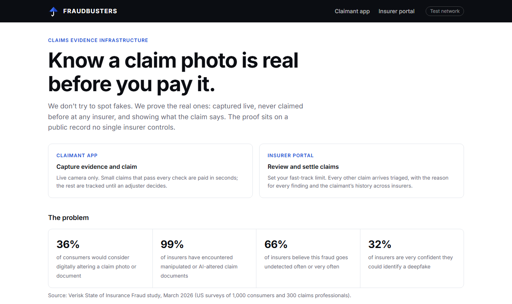
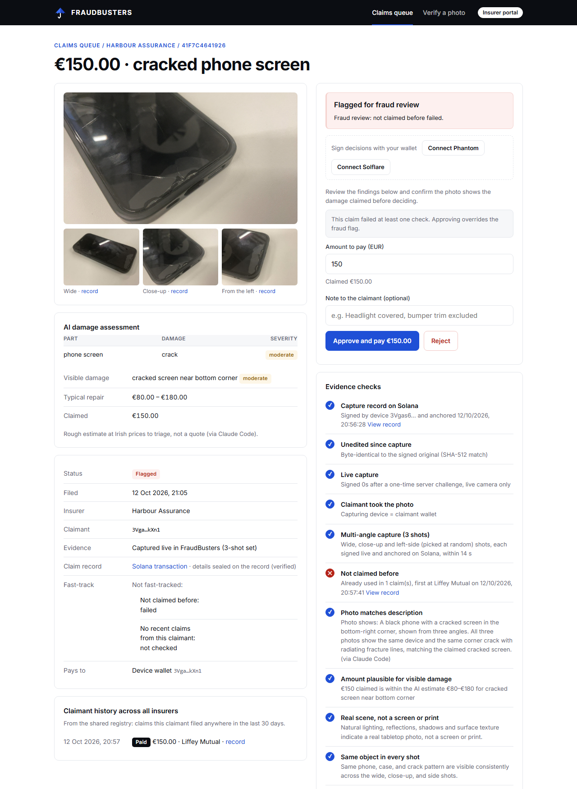
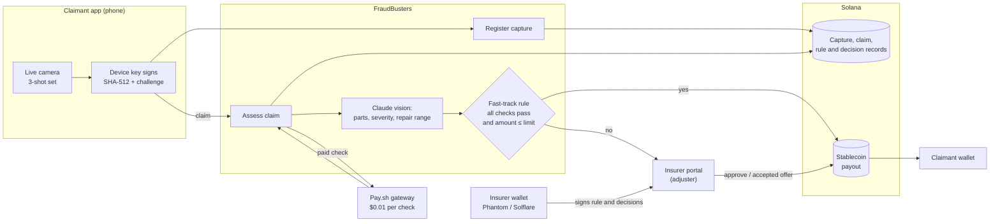
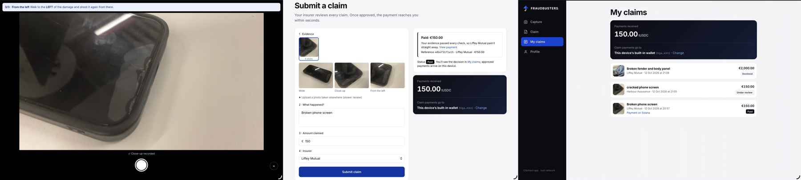

<p align="center">
  
</p>

<h1 align="center">FRAUDBUSTERS</h1>

<p align="center">
  <b>Know a claim photo is real before you pay it.</b><br />
  We don't try to spot fake insurance-claim photos. We prove the real ones, on a shared Solana record no single insurer controls.
</p>

<p align="center">
  
  
  
  
</p>

---

| | |
|---|---|
| **Demo video** | _link added on submission_ |
| **Code** | https://github.com/EmuCS/fraudbusters |
| **On-chain proof** | Real transactions, listed [below](#on-chain-proof) |
| **Run it** | [Getting started](#getting-started) (about five minutes) |



## 1. The problem

Editing a claim photo now takes seconds, and insurers are losing track of it. From the Verisk State of Insurance Fraud study (March 2026, US surveys of 1,000 consumers and 300 claims professionals):

| | |
|---|---|
| **36%** of consumers | would consider digitally altering a claim photo or document (55% of Gen Z) |
| **13%** of consumers | find it acceptable to create images of damage that never happened |
| **99%** of insurers | have encountered manipulated or AI-altered claim documents |
| **66%** of insurers | believe digital media fraud goes undetected often or very often |
| **32%** of insurers | are very confident they could identify a deepfake |

Allianz UK reported a 300% rise in cases where apps were used to distort real images, video and documents between 2022 and 2023.

Today's answer is detection: software that looks for traces of editing. Every time image generators improve, detection falls behind. And each insurer checks alone: the same genuine photo can be claimed at two insurers, and neither will ever know.

## 2. The insight: prove the real ones, don't hunt the fakes

We step out of the arms race. Instead of asking "is this photo fake?", FraudBusters asks "can this photo prove it was captured live, here, now, and never claimed before?"

A photo that wasn't taken live in our app, or was changed after capture, simply has no valid record. How good the edit was doesn't matter.

## 3. The solution: four questions before anyone pays

| | Question | How FraudBusters answers it |
|---|---|---|
| 01 | **Is it real?** | Live camera only, in a guided three-shot set: wide, close-up, and a side the server picks at random, so the claimant has to be standing at the real object. Each shot is signed by the phone against a one-time server challenge and recorded on Solana at the moment of capture. |
| 02 | **Is it new?** | Every shot is matched against every claim on the shared registry, at every insurer, even after compression or resizing. Plus the claimant's recent claims across the whole market. |
| 03 | **Does it add up?** | Claude compares the photos with the description: same object in every shot, a real scene (not a photo of a screen or print), each damaged part with damage type and severity, and a repair range. Inflated amounts get flagged. |
| 04 | **Settled?** | **Fast-track:** each insurer sets a limit (e.g. €500). A claim under it that passes every check is paid in seconds, automatically. Anything else, even one warning, goes to an adjuster, who signs the decision with their wallet. Payments settle in stablecoins with the decision on the record. |

Fast-track is decided by code, never by the AI alone: the AI's findings are inputs, and every required check must have run and passed ([`src/policies.js`](src/policies.js), with [tests](test/policies.test.js)). A real, unedited selfie passes every provenance check, but fails "photos match the description", so it is never paid automatically.


<p align="center"><sub>A claim file in the insurer portal: three-shot evidence set, damaged parts with severity, and a flag because the close-up was already used in an earlier claim.</sub></p>

## 4. Why a public record, and why Solana

**Why not just upload the photo to a server?** An upload only answers "what does it show?". It can't answer the questions fraud depends on:

| Fraud | Upload to a server | Record on Solana |
|---|---|---|
| Same photo claimed at two insurers | Each insurer only sees its own uploads | The fingerprint is already on the shared record: flagged |
| Damage from *before* the policy started | Photo dates are editable metadata | Capture time is fixed on-chain when the photo is taken |
| Photo edited after capture | Has to be detected (arms race) | Fingerprint no longer matches the signed original |
| "I sent the photos on day one" / "We never received them" | One side's word against the other's | Both sides can prove what was sent, and when |

**Why not one shared database?** Shared claims databases exist, but each is owned by a single company that insurers pay and have to trust, country by country. Whoever runs a database can change it. A public ledger can't be backdated by anyone, including us; any insurer, in any country, can check it without a contract; and our own index can be rebuilt from the chain alone ([`scripts/reindex.js`](scripts/reindex.js)), so the registry outlives any one operator. As Verisk's head of anti-fraud put it in the study above: *"This isn't a problem any one insurer can solve in isolation."*

**What goes on-chain, and what doesn't.** Never photos, names, amounts or descriptions. Only fingerprints, signatures, and a *seal* (salted hash) of the claim details, so rivals share the registry without seeing each other's books, and either side can later prove exactly what was claimed. Anyone can look up a fingerprint, like a car history check.

**Why Solana specifically.** One record per photo needs fees well under a cent and confirmation in about a second; stablecoins (USDC, EURC) are native, so the decision and the payment land in one atomic transaction; and Pay.sh lets any claims agent buy a single check for $0.01 over HTTP 402.

| Role | On-chain | Code |
|---|---|---|
| **Proof of capture** | Memo with SHA-512 + perceptual hash, device public key, ed25519 signature, capture challenge, set and shot | [`POST /api/register`](src/server.js) |
| **Shared fraud registry** | Claim record v2: fingerprint, reference, status, claimant device key, seal of the details | [`POST /api/claims`](src/server.js) |
| **Fast-track rule** | Each insurer's limit, signed by its wallet; every automatic payment names the rule it was paid under | [`/api/policies`](src/server.js), [`src/policies.js`](src/policies.js) |
| **Adjuster sign-off** | Every approve, offer or reject is signed by the adjuster's Phantom / Solflare wallet; wallet and signature go into the decision record | [`POST /api/claims/:id/decision`](src/server.js) |
| **Claimant answer** | Accepting or declining an offer is signed by the claimant's device; the signature is recorded | [`POST /api/my-claims/:id/respond`](src/server.js) |
| **Payout wallet** | Claimants link their own Phantom / Solflare wallet, signed by both the phone and the wallet | [`/api/link/*`](src/server.js) |
| **Settlement** | Stablecoin transfer and decision record in one atomic transaction | [`payout()`](src/solana.js) |
| **Pay-per-check API** | Verification behind a Pay.sh gateway: $0.01 per request, no account or API key | [`paywall.yml`](paywall.yml), [`src/payClient.js`](src/payClient.js) |

## 5. How we compare

| | AI fake detectors | Verified-capture vendors | FraudBusters |
|---|---|---|---|
| Holds up as image generators improve | No: an arms race | Yes | Yes |
| Duplicate photo across insurers | No | Through a vendor-owned database | Yes, on a shared public record |
| Anyone can verify, no vendor in the middle | No | No | Yes |
| Photos match the description, amount fits the damage | Partly | Partly | Yes |
| Fast-track payout and signed decisions on the same rail | No | No | Yes |
| How you buy it | Enterprise contract | Enterprise contract | $0.01 per check, no account |

## 6. Go-to-market

**Start where the pain per claim is highest: small, photo-based claims.** Phone and gadget cover, travel baggage, minor car damage. Claims of a few hundred euro cost almost as much to handle by hand as they pay out, and they are exactly where fast-track pays off.

**First customers: digital-first insurers and MGAs.** They already take claims through an app, so adding our capture flow is an integration, not a transformation, and their sales cycles are short. Start in Ireland, where we are based, then expand across the EU.

**Distribution:**
- **Self-serve verification API**, listed on the Pay.sh catalog: any claims system or AI claims agent can buy a check per request, with no contract, account or procurement.
- **Direct pilots** with digital insurers, starting with the Dublin insurtech scene.
- **Network effect:** every insurer that records claims makes the duplicate check more valuable for the next one. That's why a single check is priced low: the registry is worth more the more insurers use it.

**Revenue:**
- **Per check** through Pay.sh ($0.01 today), to get every insurer onto the registry.
- **Per claim handled** for the full flow (claimant capture, AI assessment, fast-track, settlement): the main revenue line, priced well below the cost of handling a small claim by hand. We will set the exact price with our first pilots.

**Demand:** 99% of insurers already see manipulated claim media, and only 32% are confident they could spot a deepfake (Verisk, March 2026). Verisk's own conclusion is that insurers need shared intelligence across carriers, which is what FraudBusters provides, without a middleman.

## 7. What's built

Everything above runs today on Solana devnet: claimant app (installable on iPhone and iPad), insurer portal, three-shot capture, cross-insurer reuse detection, Claude assessment, fast-track with signed rules, wallet-signed decisions and offers, stablecoin settlement, pay-per-check verification via Pay.sh, unit tests and an end-to-end test.

### On-chain proof

Real transactions on Solana devnet, written by the end-to-end test (`npm run e2e`) with a test stablecoin (tUSDC):

| What | Transaction | Record |
|---|---|---|
| Insurer signs its fast-track rule (Liffey Mutual, up to €500) | [4Xb4RK96…](https://explorer.solana.com/tx/4Xb4RK96jcfJPrQ4iMNPEjTM2thjeVgbSQg1ehej5jM9Lhd58Lqv87CsgSabm1SRS7V8y7A35388dYJ6YH9kv3QD?cluster=devnet) | `fraudbusters:policy:v1` · insurer · limit · adjuster wallet · wallet signature |
| Photo captured and anchored | [4fdSMxUK…](https://explorer.solana.com/tx/4fdSMxUKrxJSCKFk4FTvPjYLrFwD2K39QjHYSTyQiLVxSMCgsu5P6RfaCxBf3X7bNTcrqhzZFU4JhRjTNLrNEMY1?cluster=devnet) | `fraudbusters:photo:v1` · perceptual hash · SHA-512 · device key · signature · challenge |
| Claim registered on the shared registry | [5H2Y56JJ…](https://explorer.solana.com/tx/5H2Y56JJbeytWgh6rCxYcs2B2RCjo6QivnQg7JGvpTXyGV4KXvBW45i44Vm63X7KT7TzKbcmphLTXivfsi99pJVy?cluster=devnet) | `fraudbusters:claim:v2` · fingerprint · reference · status · claimant device · seal |
| Adjuster approves: 450 tUSDC paid with the decision in one transaction | [5B47Yz2B…](https://explorer.solana.com/tx/5B47Yz2BvMxRdkaZp1eZsa9BnLFM5e8rvxUgn8j8uehfSSZS5SXDRHKthVG6QXmNdEi4NG3fWqH3FKqppSGrSefW?cluster=devnet) | token transfer + `paid` record · adjuster wallet · adjuster signature |
| Same photo claimed at a second insurer: flagged | [4ow9KccA…](https://explorer.solana.com/tx/4ow9KccArGZL4hqhhoShw37AksefG5byz9TR2pgP9WoUF2AbuVU4HE1frCFacwPh1qz3cNz8HbsDcgDuoed93r3T?cluster=devnet) | `fraudbusters:claim:v2` · status `flagged` |

## Try it

**As the claimant, on your phone**
1. Open `/capture.html`. Optional: Share → **Add to Home Screen** to use it as an app.
2. **Capture** → **Start guided capture** → allow the camera → take the three shots it asks for: wide, close-up, then from the side it names.
3. Tap **Submit a claim with these photos**, describe the damage, enter an amount and pick an insurer. Under the insurer's fast-track limit, with every check passed, the claim is **paid on the spot**.
4. Optional: **Profile** → **Connect Phantom** (or Solflare) so payments go to your own wallet.

**As the insurer, on your laptop**

5. Open `/adjuster.html`. Under **Fast-track rules**, connect your wallet and sign a new limit for your insurer: it is recorded on Solana.
6. Claims that weren't fast-tracked are in the **Claims queue**, each with the reason. Open one to see the damaged parts with severity, the evidence checks, why it wasn't fast-tracked, and the Solana records.
7. Pay the full amount, send a lower offer, or reject. Approve the message in your wallet.

**Back on the phone**

8. **My claims** shows the decision. For an offer, tap **Accept**: the payment settles in seconds.

Things to try: submit the same photos again, or to the other insurer (flagged as reuse); photograph a screen showing a photo (flagged as screen or print); claim €2,000 for a small scratch (flagged as likely inflated); claim above the fast-track limit (goes to the adjuster).

## Architecture



## Features

**Claimant app** (installable on iPhone and iPad from the browser: Share → Add to Home Screen)
- Guided three-shot capture (wide, close-up, random left/right side), live camera only
- Each shot signed on the device against a one-time server challenge and recorded on Solana
- Fast-tracked claims paid on the spot; others tracked in My claims, with offers to accept or decline
- Connect Phantom or Solflare to receive payments in your own wallet
- Status only: fraud signals are never shown to claimants


<p align="center"><sub>Claimant app on iPad: guided capture (shot 3 of 3, from the side the server picked), a claim fast-tracked and paid on the spot, and My claims.</sub></p>

**Insurer portal**
- Fast-track rule per insurer, signed by the insurer's wallet and recorded on Solana
- Triaged queue (verified, standard review, flagged) with a reason for every finding, and why each claim wasn't fast-tracked
- AI damage assessment: each damaged part with damage type and severity, plus a repair range
- Evidence checks: capture record, integrity (SHA-512), live capture, claimant = capturing device, three-shot set, same object in every shot, real scene vs screen or print, reuse across insurers (every shot), claimant history, photo vs description, amount vs repair estimate, AI-generation labels (C2PA / IPTC / generator metadata)
- Claim details sealed on the record and verified in the claim file
- Pay in full, send a lower offer with a note, or reject; every decision signed with the adjuster's wallet
- Verify any photo against the registry (`/verify.html`), the same check other insurers buy via Pay.sh

**Engineering**
- 64-bit perceptual hash (dHash) survives messaging-app compression and resizing; SHA-512 proves byte-level integrity
- Claude assessment returns schema-validated structured output; claimant text is treated strictly as data
- Wallet-signed messages are server-issued, human-readable and bound to claim, action, amount and payee; changed amounts, other wallets' signatures and replays are refused
- If the Pay.sh gateway is unreachable, the registry is checked directly and the check is marked as not charged, instead of blocking the claim
- Unit tests for the fast-track rule (`npm test`) and an end-to-end test against a running server (`npm run e2e`)

## Tech stack

| Layer | Technology |
|---|---|
| Chain | Solana (Memo program, SPL Token), `@solana/web3.js`, `@solana/spl-token` |
| Payments | Pay.sh gateway and CLI (HTTP 402, USDC) |
| AI | Claude (Anthropic SDK, vision + structured outputs) |
| Server | Node.js 24, Express 5, sharp, tweetnacl, exif-reader |
| Wallets | Phantom and Solflare (injected providers, message signing; deep links into the wallet apps on iOS) |
| Frontend | Vanilla HTML/CSS/JS, browser camera API, installable web app, no build step |

## Getting started

```sh
npm install
cp .env.example .env         # then fill in what you need (see below)
npx pay --version            # downloads the Pay.sh binary on first run
npm run setup                # keypairs, SOL for fees, test stablecoin
npm run cert                 # self-signed HTTPS cert (phone cameras require HTTPS)
npm run dev                  # http://localhost:3000 and https://<LAN-IP>:3443
npm run gateway              # Pay.sh gateway on :1402
npm test                     # unit tests
npm run e2e                  # end-to-end test against the running server
```

| Variable | Purpose |
|---|---|
| `RPC_URL`, `CLUSTER` | Solana RPC (defaults to devnet) |
| `ANTHROPIC_API_KEY` | Enables the Claude photo assessment (needed for fast-track) |
| `CONTENT_CHECK_VIA=claude-code` | Local demos without API credits: runs the assessment through the machine's logged-in Claude Code, with all tools disabled |
| `PAYOUT_MINT`, `PAYOUT_SYMBOL` | Payout stablecoin, e.g. USDC or EURC (setup creates a test token otherwise) |
| `REVERSE_SEARCH=on` | Google Vision reverse image search via Pay.sh for uploaded photos (mainnet account required) |

## Project structure

```
src/
  server.js         API: capture, claims, fast-track, rules, decisions, claimant and insurer views
  policies.js       fast-track rule: what has to pass before money moves without a human
  solana.js         memo writes, atomic payout + decision transaction
  contentCheck.js   Claude assessment (match, damaged parts + severity, repair range, same object, screen/print)
  signals.js        AI-generation labels and metadata signals
  payClient.js      Pay.sh-paid registry checks and reverse image search
  phash.js          perceptual hashing
  store.js          local index (rebuildable from the chain)
public/             claimant app and insurer portal
scripts/            setup, end-to-end test, chain reindex, TLS cert, gateway supervisor
test/               unit tests
paywall.yml         Pay.sh gateway definition
```

## Roadmap

- **Native capture app** with hardware-backed keys (Secure Enclave / Android Keystore) and Apple App Attest / Google Play Integrity, so only genuine devices can sign evidence
- **Insurers write with their own keys**: today one service key writes the records; next, each insurer signs its own claims, and an allowlist of each insurer's admin and adjuster wallets
- **Coverage rules**: each insurer's policy (covered items, damage types, excess) checked against the AI's findings before fast-track
- **Mainnet settlement** in EURC, paid directly from the insurer's wallet
- **C2PA interoperability**: issue Content Credentials alongside the on-chain record
- **Pay.sh catalog listing**, so any claims agent can discover and buy verifications

The current build runs on Solana devnet with fictional insurers (Liffey Mutual, Harbour Assurance) and a test stablecoin.

## History

Started at BUILD IRL Vol. 1 in Dublin on 26 September 2026 (Superteam Ireland × Claude Builder Club @ Trinity College Dublin × Solana), and developed further for the Colosseum Crypto World's Fair: fast-track payouts with signed insurer rules, sealed v2 claim records, a fallback when Pay.sh is unreachable, and tests.
